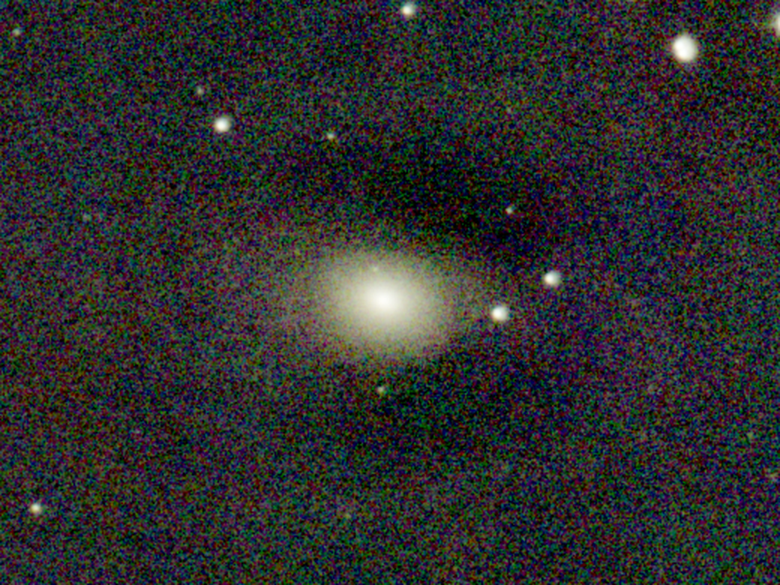
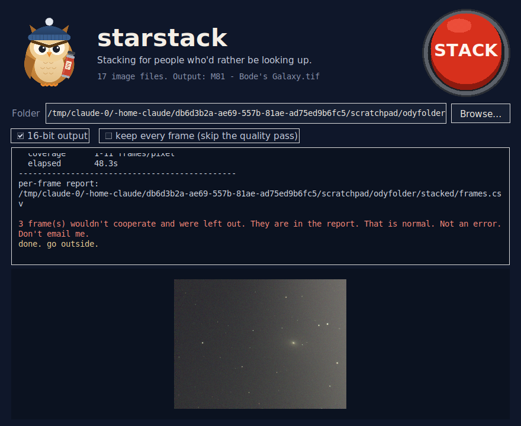
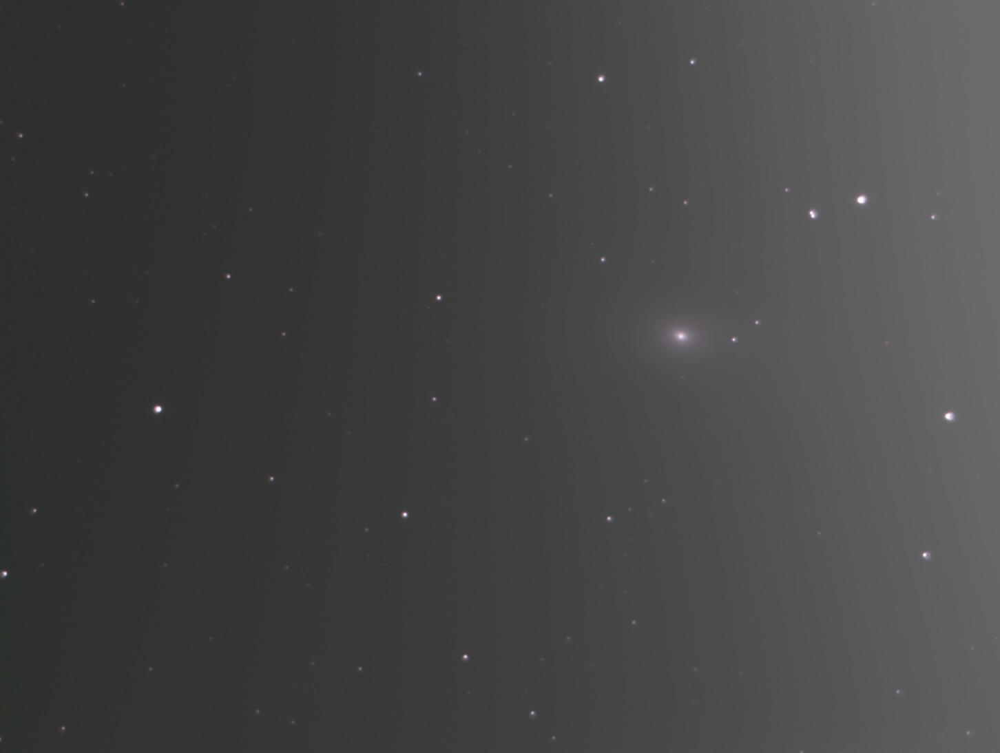
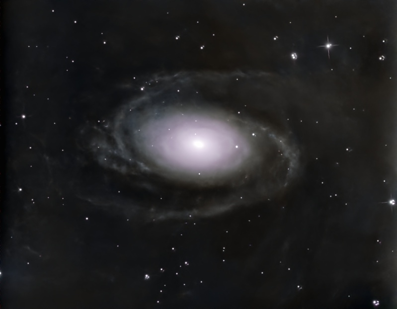
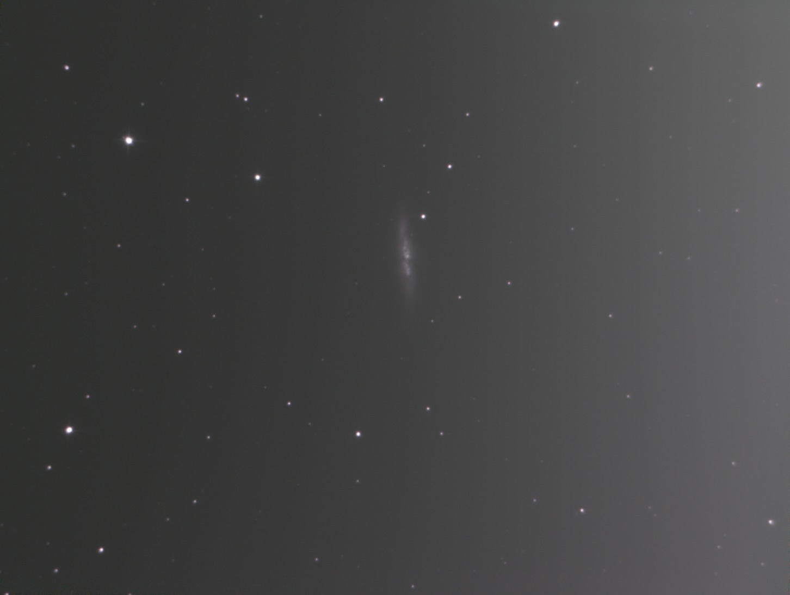
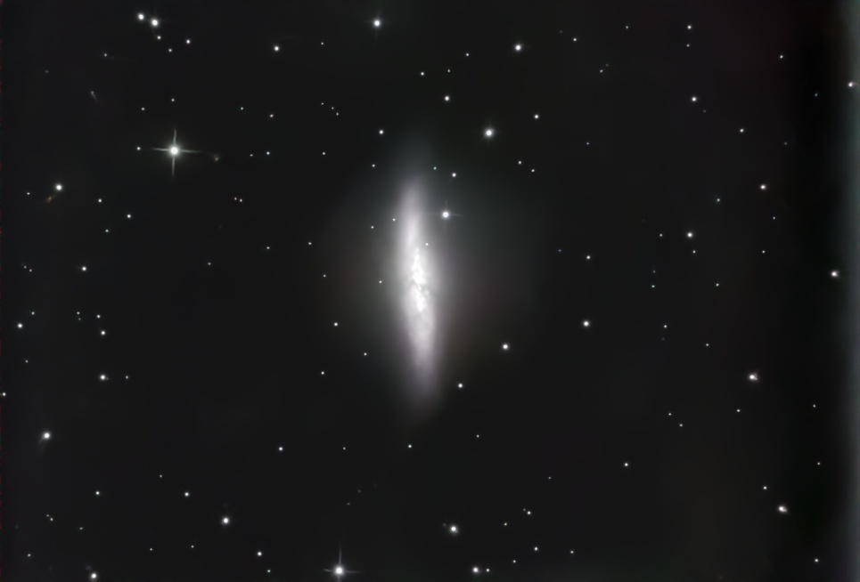

<p align="center">
  
</p>

<p align="center">
  <a href="https://github.com/kylefoxaustin/starstack/actions/workflows/ci.yml"></a>
  
  
</p>

> ### 🦉 The owl lives at [scopepull](https://github.com/kylefoxaustin/scopepull) now
>
> This window, the archive table and the StackingWizard hand-off moved there in
> October 2026: scopepull pulls every scope Kyle owns -- Odyssey Pro, Seestar
> S50 / S50 Pro, a Dwarf in December -- and the owl is its face. **starstack is
> the quick-look stacker he calls**: `pip install
> git+https://github.com/kylefoxaustin/starstack`, and scopepull's window finds
> it on PATH and turns its quick-look checkbox on.
>
> Everything below still works exactly as it did -- `starstack <folder>` is the
> stacker, `starstack --pull` still shells out to scopepull -- but the pulling
> half, and `starstack-button`, are superseded by `scopepull` and `scopepull
> gui`. See [THE_OWL_MOVES_IN.md](https://github.com/kylefoxaustin/scopepull/blob/main/docs/THE_OWL_MOVES_IN.md).

**Gets the night off your scope.** Tick your scope, press the button, and
the night's sub-frames land in an archive on your computer, sorted by night
and target. Pick a night -- or every night you've ever spent on one target --
and hand it to a stacker with the next button. The owl sits between your
smart scope and your stacker, and does the part neither of them does.

- **Seestar S50 / S50 Pro**: over Wi-Fi (station mode) or USB. Nothing to
  install; the scope is a folder and the owl copies what's new.
- **Unistellar Odyssey Pro**: through its download API, with
  [scopepull](https://github.com/kylefoxaustin/scopepull) (the owl installs it).
- **The archive**: `~/Astro/seestar/<night>/<target>/`, same for the
  Odyssey. The window lists it as a table: target, nights, frames, hours of
  sky, what's new tonight.
- **Combine nights**: pick a target and every night of it is gathered into
  one folder (hard links, no copies, no disk) ready for a stacker.
- **Hand it over**: *Open in StackingWizard* launches
  [StackingWizard](https://astrowizard.lukomatico.com/stackingwizard.html)
  on that folder. It's the stacker this owl recommends: mosaics with
  distortion correction, multi-night, flats, mono filters, a gold button
  straight into AstroWizard for the finishing. Free, and it's a better
  stacker than the owl will ever be.

The owl can still stack. Tick *quick-look stack after the pull* and it
registers, grades and sigma-clips the night into a 16-bit TIFF with a
stretched preview, mosaics included, so you know before bed whether the
night was any good. For a plain folder of frames with no scope involved it's
still the one-button stacker it started as:

```
pip install -r requirements.txt
python starstack.py /path/to/frames -o result.tif --preview look.png
```

**The window**: download `starstack-<version>-windows.exe` from
[Releases](https://github.com/kylefoxaustin/starstack/releases) (one file,
nothing to install; see *Install* for the blue box Windows shows), or
`python button.py`. Drag a folder onto the exe to stack it straight away.

<p align="center">
  
</p>

*M81 (Bode's Galaxy), 710 × 4 s from a Unistellar Odyssey Pro under Austin,
Texas skies. starstack was pointed at the session folder exactly as the scope
exported it: dark applied, Bayer mosaic detected, 695 frames aligned and
sigma-clipped, the rest rejected. The linear stack was then stretched and
finished in AstroWizard.*

## Why this exists

It started as a stacker, written by someone who got grumpy one evening at
sequence files, process folders and `input images have different sizes`.
That stacker is still in here and still has one button. But the part that
turned out to matter most was the part before stacking: getting the night
off the scope at all. A Seestar hides its subs behind a network share that
current Windows refuses to open; an Odyssey hands out one zip per
observation through a portal. Then the frames sit in a dozen folders named
by timestamp and nobody can tell which nights were NGC 7000. Meanwhile a
dedicated stacker like StackingWizard ships a release a week and does
things -- field distortion, flats, mono filter sets -- this owl will never
do.

So the owl does the unglamorous half: fetch, file, count, combine, hand
over. Stack too, if you ask, and it's quick.

## What a night looks like

Tick **Seestar** (or **Odyssey**), press **PULL**. The log says what came
down ("NGC 7000_mosaic: 602 new subs of 602"), the table underneath gains a
green row, and the status line says how much sky the archive now holds.
Pick that row and press **Open in StackingWizard**: the folder opens there
(and in Explorer, and its path is on the clipboard, because StackingWizard
takes a folder by picker or drag-and-drop). Pick the *target* row instead --
"NGC 7000, 3 nights" -- and the button reads **Combine 3 nights →
StackingWizard**: every sub of every night is gathered into
`combined/NGC 7000/` as hard links and handed over as one long session.
Tick *quick-look stack after the pull* and the button reads **PULL+STACK**:
the owl stacks the archive itself after pulling, skipping nights it has
already done, and the preview appears on the right.


## What it does without being asked

- **Reads whatever is in the folder** — TIFF, FITS, PNG, JPG, 8/16/32-bit,
  mono, RGB, or raw Bayer.
- **Finds your darks by name.** Anything with `darkframe`, `dark_`, `_dark`,
  etc. in the filename is a dark. They get median-combined into a master dark
  and subtracted from every light before anything else happens.
  `--darks some/folder` if they live elsewhere; `--no-darks` to ignore them.
- **Ignores things that aren't subs.** A scope's own finished stack, a
  stretched 8-bit `preview.jpg`, a thumbnail — anything named like one
  (`preview`, `thumb`, `stacksum`, `stacked`, `master`, `final`) or that is
  8-bit when the real subs are 16-bit is removed from the pile. It tells you
  so. You're welcome.
- **Does not care about mixed frame sizes.** A camera that truncated the
  last few frames, or a mix of two ROIs, is not an error. Star alignment maps
  every frame onto the reference frame's grid regardless of its own size, and
  the reference is only ever picked from frames of the dominant size, so a
  straggler can never decide the geometry for everyone else. (With
  `--no-align` they're cropped/padded top-left-anchored instead.)
- **Skips bad frames instead of dying.** Unreadable file, frame with no
  stars, alignment that won't converge — it's logged, left out, and the run
  continues. `--report frames.csv` tells you exactly which and why.
- **Debayers raw frames, TIFFs included.** FITS get the pattern from the
  `BAYERPAT` header -- but the pixels get a vote. A mosaic has four 2×2
  phases with different means and a matching green pair on one diagonal;
  if the header names the wrong diagonal (RGGB/BGGR vs GRBG/GBRG), the
  header is wrong, the pixels win, and the log says so. TIFF/PNG have no
  header, so the pixels are all it has: when it sees a mosaic it assumes
  RGGB (Unistellar) and says so. Force with `--debayer RGGB`;
  `--debayer none` for frames that are already colour.
- **Judges every frame and drops the bad ones.** Each sub gets measured
  before it's warped: star count, background, noise, and a median star FWHM
  in pixels. Frames that are blurry, cloudy or starved *relative to the rest
  of the session* are dropped (never more than a quarter of them), and the
  survivors are weighted by sharpness and noise so a crisp frame counts for
  more than a soft one. No thresholds to tune — everything is relative to
  the night you actually had. `--keep-all` and `--no-weights` if you disagree
  with its judgement. All the numbers land in `--report`.
- **Picks its own reference frame** — the one with the most detectable stars
  out of a sample of the dominant-size frames. Override with `--ref N`.
- **Star-aligns** with astroalign (translation + rotation + scale), so
  untracked and dithered data is fine.
- **Level-matches** every frame to the reference (median + spread) before
  combining, so a sky-brightness gradient across the session doesn't wreck
  the stack. `--no-normalize` to skip.
- **Sigma-clipped mean** by default — satellites, planes and cosmic rays:
  goodbye. `--method mean` for a fast streaming average with no scratch
  file, `--method median` if you'd rather.
- **Fetches the frames itself, from two scopes.** A Unistellar Odyssey Pro
  (`--pull`, via scopepull and the scope's download API) or a ZWO Seestar
  S50 / S50 Pro (`--pull-seestar`: the scope is a folder on USB or a share
  on Wi-Fi, so it's a copy). Either way: new frames into an archive split by
  night. `--pull-only` stops there; without it the archive is stacked and
  the already-stacked rule keeps the next night cheap. In the window each
  scope is one row and one tick, and stacking is the *quick-look* checkbox.
- **Keeps the archive honest.** `--index ROOT` lists every session (target,
  night, frames, exposure, integration, when it was pulled) as JSON; the
  window shows the same as a table. `--combine TARGET` (folder = the archive
  root; `--nights N1,N2` to pick) gathers every night of a target into
  `combined/TARGET/` as hard links, so a stacker sees one long session and
  the nights themselves are untouched.

## Whole-night mode

Point it at the folder *above* the sessions -- the `unistellar_observations`
download from an Odyssey, a night of Seestar targets, a scopepull archive,
anything with one subfolder per target -- and it stacks every session in
turn, naming each output after the target from the scope's manifest when
there is one:

```
python starstack.py "unistellar_observations (1)"

whole night: 4 session folders under unistellar_observations (1). Stacking all of them into ...\stacks. Go to bed.
[1/4] M81 - Bode's Galaxy
...
  the night
  M81 - Bode's Galaxy              ok
  M27 - Dumbbell Nebula            ok
  M13 - Hercules Cluster           ok
  NGC 7000                         ok
  4/4 sessions stacked in 1042s  ->  ...\stacks
done. all of it. go to bed.
```

Each target gets a `.tif`, a `_look.png` preview and (with `--report`) a
`_frames.csv`. Two sessions of the same target keep both, suffixed by the
session folder. One session failing does not sink the night. The output
folder from a previous run is recognised and not mistaken for a session, and
a session whose output already exists and is newer than its frames is
skipped ("already stacked this one on Tue Sep 09 ... Skipping."), so re-running
a night after a new target lands only stacks the new target. `--restack` if
you've changed your mind about the old ones (on the button: *Options… → Redo
sessions that already have a stack*; it turns itself off after the run, so
the next night doesn't cost 95 minutes of M81 again).

## Straight off the scope: `--pull` (Unistellar Odyssey Pro)

Skip the download step entirely. `--pull` fetches your new observations off a
Unistellar Odyssey Pro with [scopepull](https://github.com/kylefoxaustin/scopepull)
-- a puller written for that scope's API specifically; it doesn't know any
other -- and then stacks them. Telescope to stacked image, one command:

```
python starstack.py --pull                     # pull everything new, stack every session
python starstack.py --pull --pull-target M81   # just one object
python starstack.py --pull ~/Astro/tonight     # pull into (and stack) a folder you choose
```

(`starstack --pull` if you `pip install`ed it; `starstack.exe --cli --pull`
from the Windows build. In the window it's the **Odyssey** row: tick it and
the button reads PULL+STACK.)

The owl gets on the scope's Wi-Fi API, downloads only what you don't already
have (verified, organised, raw Bayer + FITS), and hands the archive straight to
the stacker. With no folder named it stacks scopepull's own archive, wherever
scopepull's config says that is. Nothing new on the scope? It stacks what's
already there -- which, thanks to the already-stacked rule above, means it
does nothing and says so, rather than another twenty minutes of M81. If
scopepull fails (scope unreachable, Direct Data Download off, or it crashed)
the owl says why and does not stack blind.

`--pull` needs scopepull on your PATH -- it's a separate, isolated install so it
never touches starstack's own dependencies. It's on
[PyPI](https://pypi.org/project/scopepull/); no account needed:

```
uv tool install scopepull      # or:  pipx install scopepull
```

(`uv tool install git+https://github.com/kylefoxaustin/scopepull` if you want
whatever is on `main` today rather than the last release.) Either way needs
Python 3.11 or newer on the machine -- scopepull's requirement, not
starstack's; starstack itself is happy on 3.10.

Then enable **Direct Data Download** in the Unistellar app (once), join the
scope's Wi-Fi (`Odyssey-xxxx`), and run `starstack --pull`. If scopepull isn't
installed, the owl tells you how to get it and carries on being a stacker.

## Straight off the scope: `--pull-seestar` (ZWO Seestar S50 / S50 Pro)

A Seestar needs no puller at all, because a Seestar is a folder. Plug it in
by USB and its storage shows up as a drive with `MyWorks` on it; put it in
**station mode** (Seestar app → Advanced) and the same `MyWorks` is a guest
network share, `\\seestar\EMMC Images`. Either way, every target's
sub-frames sit in `MyWorks\<target>_sub\` as `Light_..._<date>-<time>.fit`,
so the pull is a copy: every sub the archive hasn't got, into
`~/Astro/seestar/<night>/<target>/`, then the archive gets stacked like any
other whole night.

```
python starstack.py --pull-seestar                 # look for it: USB drive first, then \\seestar
python starstack.py --pull-seestar=D:              # the USB drive
python starstack.py --pull-seestar=10.0.1.215      # by address, when the name doesn't resolve
python starstack.py --pull-seestar=seestar --pull-target "M 31"
```

(`starstack.exe --cli --pull-seestar` from the Windows build; write the
address with `=` so a folder after it isn't taken for the address. In the
window it's the **Seestar** row: tick it, leave *at* empty unless the owl
can't find the scope on its own, press the button.)

What it copies: the `.fit` subs, and only those -- framing-mode
(`*_mosaic`) sessions included, since the owl tiles those (next section).
The JPEGs and thumbnails next to them, the scope's own `Stacked_*.fit`, and
the `Lunar_*` and `*_video` folders stay on the scope. A sub taken before noon belongs to the evening
before, so a session that runs past midnight is one night, not two. A second
pull copies nothing and says so; a pull that finds nothing new still stacks
the archive, which the already-stacked rule turns into "nothing to do".
The scope isn't touched: the owl only ever reads from it.

**Seestar over Wi-Fi on Windows 11.** The scope's share is an old-fashioned
one -- no password, and it can't sign its traffic -- and since the 24H2
update Windows refuses both by default, so `\\seestar` looks like it
doesn't exist even though `ping seestar` answers. Two settings fix it,
once, in an **administrator** PowerShell (no reboot):

```
Set-SmbClientConfiguration -RequireSecuritySignature $false -Force
Set-SmbClientConfiguration -EnableInsecureGuestLogons $true -Force
```

Those loosen your laptop's file-sharing client for every share it talks
to, which is fine on a home network and is the trade every Seestar owner on
a current Windows makes. The owl does the remaining step itself (the guest
login to the scope that `net use \\seestar\IPC$ /user:guest` would do by
hand), so after those two lines the Seestar row just works. USB needs
none of this.

## Mosaics: frames that don't share a field

A Seestar in framing mode doesn't shoot one field, it walks one: every sub
is a full frame at a slightly different pointing, panels overlap their
neighbours by a fifth or so, and the far panels don't overlap each other at
all. A normal stack of that crops everything to the first frame and throws
the rest away. So the owl tiles instead, on its own, whenever the folder is
called `*_mosaic` or the headers show the pointing wandered more than a
third of a frame (`--mosaic on|off` to insist).

How: the FITS headers say where each frame pointed (`RA`/`DEC`) and how big
a pixel is (`XPIXSZ`/`FOCALLEN`), but not which way the camera was turned.
So the frame nearest the middle of the field goes down first, its
neighbours are matched to it star for star, and from those placements the
camera's orientation is fitted -- the log says "camera turned 32.5 deg and
mirrored relative to north-up". After that every frame is predicted onto
the canvas from its header, matched against the mosaic-so-far at that spot,
and placed where the stars say. Field rotation on an alt-az mount comes out
in the per-frame match. Levels: one camera, one gain, so a frame is only
ever shifted, per channel, to agree with the mosaic where the two overlap --
a panel full of nebula keeps its nebula.

Combining is done in passes rather than a scratch cube (a 3-hour session on
a 65-megapixel canvas would be hundreds of gigabytes): pass 1 places the
frames and gathers each pixel's mean and spread, passes 2 and 3 re-warp
every frame and keep the pixels within sigma of the mosaic, weighted like
the normal stacker. The accumulators live on disk, a few gigabytes for a big
night; if the scratch folder hasn't the room the owl keeps the plain mean
and says so. The quality pass, the report and the preview work as usual;
`coverage` in the summary runs from 1 at the edges to the full count in the
overlaps. Output is one TIFF the size of the field, so a big mosaic is a
big file (a 3.5-hour S50 Pro walk is about 8500 x 7600 px, 400 MB at 16
bits).

Verified on a synthetic walk (five panels, visited three times, camera at
37 deg and mirrored, 6 deg of field rotation): all 30 frames placed, and
the result matches the field they were cut from to the per-frame noise,
with no level steps at the seams. Frames without `RA`/`DEC` can't be
placed and are left out with a note.

## Sorted folders, and sorting one

Seestar saves a target as `lights/` and `darks/` subfolders. starstack reads
that layout as one session -- lights from `lights/`, darks from `darks/`,
and a `flats/` or `bias/` folder is noticed (flats are next). A folder of
such targets is a night, same as an Odyssey download.

The Odyssey does the opposite: one pile, everything in it. If you'd rather
have the tidy layout -- for starstack, for Siril, for anything -- there's a
sort:

```
python starstack.py "20260201T033715_387" --sort --dry-run   # shows the plan
python starstack.py "20260201T033715_387" --sort             # does it

sorting 20260201T033715_387
  lights       710   e.g. 20260201T033719_987_StackInput.tiff .. 20260201T042552_246_StackInput.tiff
  darks          1   e.g. 20260201T033720_070_DarkframeMean.tiff
  extras         2   e.g. 20260201T042554_221_StackSum.tiff .. preview.jpg
moved 713 files into darks, extras, lights. The stragglers (manifest, csv, whatever) stayed put. Point any stacker at it now.
```

It classifies by the same rules the stacker uses, moves files into
`lights/ darks/ flats/ bias/ darkflats/ extras/` inside the same folder,
leaves `manifest.json` and anything that isn't an image where it was, never
copies, and prints every group so it's reversible. Run it on a whole night
and every session gets sorted. Run it twice and it shrugs.

## scopepull archives

If you pull observations off the Odyssey with
[scopepull](https://github.com/kylefoxaustin/scopepull) instead of the app,
each one lands as its own folder:

```
~/Astro/odyssey/2026-01-31/m81-bode-s-galaxy__38102043/
├── frames/          StackInput .tiff + .fits twins   <- lights
├── calibration/     DarkframeMean .tiff + .fits      <- the dark
├── reference/       StackSum.tiff, preview.jpg       <- the scope's own stack; ignored
└── observation.json                                  <- the manifest, plus pull info
```

starstack reads that as-is. Point it at one observation, at a night
(`2026-01-31/`), or at the whole archive (`~/Astro/odyssey/`) and it does the
right thing at each level: `frames/` are the lights, `calibration/` the dark,
`reference/` is never opened, and the output is named from the manifest
inside `observation.json`. Every frame exists twice in there (the scope's
TIFF and scopepull's FITS of the same pixels, with `BAYERPAT`, `EXPTIME` and
friends filled in); it uses the FITS and says so, rather than stacking each
frame twice. An observation still downloading (`*.partial`) is left alone.

```
scopepull archive: frames/, calibration/. reference/ is the scope's own stack; not touching it.
  711 frames come as both TIFF and FITS of the same pixels. Using the FITS -- it has the headers. The TIFFs are not being stacked twice.
scopepull pull: M81 - Bode's Galaxy  710 x 4.0s, gain 20, IMX415.  The scope itself gave up on 15 of them. We'll see.
```

## The button

`button.py` is the Big Red Button as a window, one screen: the scope rows,
the button, the log, the archive table, the picture, and a footer that hands
a night to a stacker. It runs `starstack.py` underneath, so the CLI stays
the source of truth and the window is just a face. Nothing to install
beyond Python's own tkinter.

The button reads **PULL** when a scope row is ticked, **PULL+STACK** when
the *quick-look stack after the pull* box is ticked too, and **STACK** when
no scope is ticked and the Folder row points at frames. The **archive
table** shows the selected scope's archive (or the Folder row's, if it's a
folder of nights): one bold row per target with its nights, frames, hours of
sky, and when each night was pulled; tonight's rows are green. Pick a night
and **Open in StackingWizard** / **Open folder** come alive; pick a target
with several nights and the green button becomes **Combine N nights →
StackingWizard**. The owl finds StackingWizard on its own (Downloads, the
Desktop, Program Files); if it can't, it asks once and remembers.

When it does stack, it knows the difference between one session and a
whole night, names outputs after the target, and writes into a `stacked/`
(one session) or `stacks/` (whole night) folder next to your frames -- or
into any folder you pick in the Output row, which it remembers. The log
scrolls -- wheel, scrollbar, or arrows / PgUp / PgDn / Home / End -- and it
stops following the output while you're reading back, then follows again
once you hit End.

While a stack is running the big red button reads **PAUSE**: press it and
the stacker and its worker processes freeze where they stand (the owl shuts
his eyes), press **RESUME** and they pick up exactly there. Nothing is lost;
only the time-left estimate gets confused. **Stop** in the footer abandons
the run for good.

**Odyssey** is the row for people who own a Unistellar Odyssey Pro and have
[scopepull](https://pypi.org/project/scopepull/) installed -- scopepull
speaks the Odyssey's own download API and nothing else, so this row is for
that scope only (Seestar owners have their own row, next). Tick *Pull new
observations off the Odyssey Pro first* and the big red button becomes
**PULL+STACK**: on your scope's Wi-Fi, one press downloads whatever is new
into scopepull's archive (or the folder you named, if you named one), then
stacks the archive -- targets already stacked are skipped, so a quiet night
costs seconds. A *target* box narrows the pull to one object. Until
scopepull is found, the row says so and offers an **Install scopepull…**
button: one click finds a Python 3.11+ on the machine (or asks `winget` for
one), runs `pip install --user scopepull` with the output in the log, and
looks again -- no terminal needed. It also finds scopepull where pipx and
uv put it even when Windows hasn't refreshed PATH since you installed it.
At startup the window also asks PyPI, once, whether a newer scopepull
exists and offers **Update scopepull…** if so, and asks GitHub whether a
newer starstack exists and mentions it in the log. One small request each,
nothing sent, three-second timeout, silent when there's no internet (which,
on the scope's Wi-Fi, there isn't).

**Seestar** is the row for a ZWO Seestar S50 or S50 Pro, and it needs
nothing installed: the scope is a folder. Tick *Pull new subs off the
Seestar first* and the button reads **PULL+STACK**; one press copies every
sub-frame the archive hasn't got into `~/Astro/seestar/<night>/<target>/`
(or the folder you named), then stacks the archive. The owl looks for the
scope on its own -- a USB drive with `MyWorks` on it first, then
`\\seestar` over Wi-Fi in station mode -- and the line under the row says
where it found it ("Seestar on Wi-Fi at seestar (10.0.1.215)") or why not.
The *at* box is for when it can't: a drive letter, a folder, a UNC path, or
the scope's address from the Seestar app. Ticking one scope's row unticks
the other; a press pulls from one scope. What is and isn't copied, and the
two Windows settings a Wi-Fi pull needs, are under *Straight off the scope*
above. While the download runs the owl shuts
his eyes; there is nothing to judge yet.

**Options…** opens the overrides: every flag in the table below, with a plain
name, the default marked, and a "Reset to how the owl likes it" button. The
main window stays folder / button / log / picture; when something is set
off-default it says so in one muted line next to the button ("options: keep
every frame, median") so nobody wonders why a stack came out different.
One of them is a one-shot: *Redo sessions that already have a stack* re-does
a whole night that's been stacked before (after a fix, or a change of mind)
and unticks itself when the run ends.
Settings stick between launches (`~/.starstack.json`).

**Copy log** puts the whole log on the clipboard, for pasting at whoever is
helping you. The version sits under the tagline; when a newer starstack is
out, that line says so and clicking it opens the releases page. While the
owl works the log has most of the window; when the stack is done the picture
takes over and the log becomes a strip (drag the bar between them if you
disagree).

<p align="center">
  
</p>

## What it says while it works

It narrates. Briefly, and with opinions. (Condensed from the real 710-frame
M81 run.)

```
713 lights, 1 dark. Fine.
Unistellar session: M81 - Bode's Galaxy  710 x 4.0s, gain 321, IMX415.  The scope itself gave up on 298 of them. We'll see.
found 20260201T042554_221_StackSum.tiff. That's a finished stack. Removed it from the pile. You're welcome.
found preview.jpg. That's a JPEG. Removed it from the pile. You're welcome.
  710 actual subs. Proceeding.
master dark: 1 frame, median 0.03841. Subtracting it from everyone.
no Bayer header, because TIFF. Looked at the pixels instead: it's a colour mosaic. Going with RGGB. If the galaxy comes out blue, --debayer BGGR.
reference: 20260201T034056_007_StackInput.tiff (38 stars). Everyone else lines up to this one.
scratch cube: 13.24 GB in C:\Users\you\AppData\Local\Temp\starstack_x1. It's temporary. Relax.
  registering 710/710  kept 706
  quality check: FWHM median 2.3 px, 20 stars per frame. Dropped 30 -- 30 blurry. They know what they did.
  weighting the rest by sharpness and noise (0.8x to 1.5x).
combining 676 frames (sigma). This is the slow part -- every pixel gets a vote and the outliers get thrown out. Satellites, planes, cosmic rays: your time is coming.
  combining rows 1094/1094  (100%)  outliers: gone.
writing stacked\M81 - Bode's Galaxy.tif
done. go outside.
```

`-q` if you'd rather it kept quiet.

## Output

- `-o result.tif` — 32-bit float linear TIFF by default.
- `--bits 16` — 16-bit integer instead.
- `-o result.fit` — FITS instead of TIFF (either bit depth).
- `--preview look.png` — an auto-stretched PNG so you can see what you got
  without opening anything else.

The output is **linear and unstretched**, the way a stack should be. That is
not the finished picture; it's the raw material for one. Stretch it in
whatever you like — AstroWizards, Siril (this is the part of Siril that is
fine), GraXpert, Photoshop, GIMP.

### What the owl hands you, and what you do with it

Left: the `_look.png` preview starstack writes, straight off the stack — a
plain auto-stretch of the linear data, sky gradient and all. Right: the same
stack after AstroWizards did the gradient removal, stretch, colour and
sharpening. **The owl stacks. It does not do the pretty part.** Both nights
were pulled off the Odyssey with scopepull and stacked from the archive
folder, untouched.

<table>
  <tr>
    <th align="center">starstack output</th>
    <th align="center">finished in AstroWizards</th>
  </tr>
  <tr>
    <td></td>
    <td></td>
  </tr>
  <tr>
    <td colspan="2" align="center"><i>M81, Bode's Galaxy</i></td>
  </tr>
  <tr>
    <td></td>
    <td></td>
  </tr>
  <tr>
    <td colspan="2" align="center"><i>M82, the Cigar Galaxy — edge-on, bright starburst core, dust lanes across it</i></td>
  </tr>
</table>

The point of the left column is what's *not* wrong with it: round stars to
the corners, a core that isn't clipped, dust lanes that survived the sigma
clip, colour that is warm where it should be. The gradient is the sky over
Austin, faithfully recorded, and is the first thing any processing tool
takes out.


## Options you may want

| flag | what |
|---|---|
| `--darks PATH` | folder or glob of darks (in addition to name-detected ones) |
| `--no-darks` | ignore darks entirely |
| `--keep-all` | skip the quality pass; nobody gets dropped for being blurry |
| `--no-weights` | every kept frame counts equally |
| `--debayer RGGB\|BGGR\|GRBG\|GBRG\|none\|auto` | Bayer pattern (default auto) |
| `--method sigma\|mean\|median` | combine method (default sigma) |
| `--sigma 3.0` | clip threshold in MADs |
| `--ref N` | force reference frame index |
| `--no-align` | frames are already registered |
| `--max-frames N` | stop after N lights (quick test runs) |
| `--bits 16\|32` | output bit depth |
| `-j N` | worker processes (default: CPU count, max 8) |
| `--report file.csv` | per-frame status, plus stars / FWHM / background / noise / weight |
| `--sort` / `--sort --dry-run` | sort a one-pile folder into lights/ darks/ ... and stop |
| `--pull` / `--pull-target TEXT` | fetch new observations off the scope with scopepull first, then stack the archive |
| `--restack` | whole-night mode: redo sessions whose output already exists and is up to date |
| `--mosaic auto\|on\|off` | tile frames that don't share one field onto one canvas (default auto: `*_mosaic` folders, or wandering headers) |
| `--pull-only` | with a pull: fetch, list the archive, stop. No stacking |
| `--index ROOT` | list the archive as JSON lines (the window's table) |
| `--combine TARGET` / `--nights N1,N2` | gather a target's nights into `<root>/combined/TARGET` (hard links) |
| `--pull-seestar[=WHERE]` | copy new subs off a Seestar (USB drive, `\\seestar`, a host/IP or a folder) into `~/Astro/seestar`, then stack |
| `--scratch DIR` | where the temporary cube goes (default: system temp) |
| `--no-log` | don't write the .log next to the output |
| `-q` | quiet |

Point `folder` at a parent of session folders instead and you get whole-night
mode (above); `-o` then names the output *folder*.

## Disk and memory

Sigma clipping needs every registered frame at once, so they go into a
temporary memory-mapped scratch cube (`frames × height × width × channels × 4
bytes` — 700 colour frames at 1452×1094 is about 13 GB; 700 frames from a
24-megapixel DSLR would be over 200 GB). It's created in your temp folder and
deleted when the run finishes. Before it starts, starstack checks the free
space there: if the cube won't fit it says so and falls back to a streaming
mean (no scratch file, but no outlier rejection or quality pass either)
rather than filling the drive and dying at 70%. `--scratch D:\somewhere`
puts the cube on a drive with room; `--method mean` streams on purpose.

## What it leaves behind

Next to the output: the stack, the `_look.png` preview, `frames.csv` if
asked, and a `.log` with everything the owl said during the run (append-only,
one header line per run) -- so when something goes wrong there is a file to
attach rather than a memory of a window. `--no-log` if you'd rather not. The
summary also reports total integration (`676 x 4s = 45m 04s`), and the
output file carries it: `EXPTIME`, `EXPOSURE`, `OBJECT`, `STACKED` in a
FITS header, or the same as a JSON description tag in a TIFF.

## Smart scope notes

- **Unistellar Odyssey**: the portal only hands out TIFFs, and they are
  16-bit single-channel RGGB Bayer mosaics, LZW-compressed, 1452×1094 (a 2×
  downsample of the IMX415). The pixel detector catches the mosaic and
  debayers as RGGB — verified on a real M81 session: warm yellow core, white
  stars. A session folder also holds `DarkframeMean.tiff` (used as the master
  dark), `StackSum.tiff` (the scope's own finished stack, 1452×1088, the
  file that makes Siril's `stack` fail with "different sizes"), `preview.jpg`
  and `manifest.json` (read for target/exposure/gain). Point the tool at the
  session folder as-is; it sorts all of that out. Note the manifest says the
  *sensor* is `BAYER_GBRG`; the exported pixels are RGGB (the export flips
  rows). starstack measures the pixels, so it doesn't care what the manifest
  claims. Pulled with [scopepull](https://github.com/kylefoxaustin/scopepull)
  instead? See *scopepull archives* above -- same data, tidier folder. One
  wrinkle: archives pulled with scopepull 0.1.0 have FITS that say
  `BAYERPAT = GBRG` (the sensor's pattern, copied from the manifest). Versions
  of starstack before 0.2.15 believed that header and stacked those sessions
  with the colours swapped; 0.2.15 checks the header against the pixels and
  overrules it. If a stack from before looks wrong, `--restack` it.
- **Seestar S50**: sub-frames are 1080×1920 16-bit FITS with `BAYERPAT =
  'GRBG'` in the header (not RGGB -- the header is what starstack reads, so
  it gets this right without being told). The scope keeps a target's results
  in `MyWorks/M81/` and the frames next door in `MyWorks/M81_sub/`, as
  `Light_M 81_10.0s_IRCUT_<timestamp>.fit` with a `.jpg` and a `_thn.jpg`
  beside every one of them. Point starstack at `MyWorks` and each `_sub`
  folder is one session named after the target, the results folder is not
  mistaken for a second one, and the 1,400 JPEGs are removed from the pile
  in two lines. Point it at `M81/` by mistake and it says "that's the results
  folder, the frames are next door" and uses them.
- **Seestar S50 Pro**: same `MyWorks` layout, same honest `BAYERPAT = 'GRBG'`,
  bigger sensor: subs are 3840×2160 16-bit FITS (2.9 µm pixels, 260 mm,
  `FILTER = 'LP'` or `IRCUT`), 16.6 MB each, so a scratch cube for 300 of them
  is 9 GB. Verified on a real 21-sub NGC 7000 session, pulled over USB
  (`D:\MyWorks`) and over Wi-Fi (`\\seestar\EMMC Images`, Samba 4.19,
  guest): the owl's stack matches the scope's own for colour, and the 30 % of
  the folder that's JPEGs and thumbnails never leaves the scope.
- Files that came *out of Siril* are 32-bit float, already-debayered or
  already-converted. That's why other stackers think they're finished
  products. This tool doesn't care — it reads them like anything else.

## Install

**Just want the button?** Windows 10 / 11:

1. **Download** `starstack-<version>-windows.exe` from the
   [Releases](https://github.com/kylefoxaustin/starstack/releases) page.
   Nothing to install; it just runs. Put it anywhere.
2. If a blue box says **"Windows protected your PC"**: click **More info**,
   then **Run anyway**. Once per download.
3. Double-click it, point it at the night's folder, press the button. Or
   drag a folder onto the exe: that *is* the button press.

One file, the owl is its icon, Python and everything else are inside it.
It's big (a couple hundred MB -- numpy, scipy and friends are in there) and
the first launch takes a few seconds while it unpacks itself. No installer,
nothing in the registry, delete the file and it's gone. No account anywhere:
not GitHub to download it, not PyPI, nothing. `starstack.exe --cli ...` is
the full command line, same flags as below.

Why the blue box? Windows trusts programs that are code-signed, and a signing
certificate costs real money every year; this is a hobby project, so the exe
isn't signed and SmartScreen will ask every time you download a new version,
not just the first. What you get instead is a checksum: every release has a
`SHA256SUMS.txt` beside the exe and the same hash in its notes. In PowerShell,
`Get-FileHash starstack-<version>-windows.exe` should print that hash; if it
doesn't, you don't have the file this page built. And if you'd rather not
take a stranger's word for any of it, the source is right here and
`build_exe.bat` makes the same file on your own machine.

Windows Defender may go further and call a release a virus (`Wacatac`,
`Wacapew`, anything ending in `!ml`). That's the heuristic reacting to how
PyInstaller packs a program -- the same launcher bytes as thousands of other
Python apps, so when one of *those* is bad, all of them get flagged for a
while. Nothing in starstack phones home, installs, or touches anything
outside the folder you point it at. Releases are built with a launcher
compiled fresh on the build machine to avoid exactly this; if it still
happens, Windows Security -> Protection history -> Allow, or build it
yourself.

To build that exe yourself: `build_exe.bat` (needs Python; it installs
PyInstaller and produces `dist\starstack.exe`). Releases are built by
GitHub Actions on a Windows runner whenever a `v*` tag is pushed.

**Have Python?** Either way works; the second gives you a `starstack`
command you can run from anywhere. `pip` downloads from PyPI without any
account -- accounts are for people *uploading* packages, not installing them.

```
git clone https://github.com/kylefoxaustin/starstack
cd starstack
pip install -r requirements.txt
python starstack.py "C:\path\to\your\session folder" -o result.tif --bits 16 --preview look.png
```

```
pip install git+https://github.com/kylefoxaustin/starstack
starstack "C:\path\to\your\session folder" -o result.tif --bits 16 --preview look.png
starstack-button
```

`pytest -q` runs the test suite: unit tests for the Bayer detector, dark
detection, session discovery and the sorter, an end-to-end stack of a
synthetic data set that checks the hot pixels actually died, and a synthetic
Seestar `MyWorks` layout (GRBG header, `_sub` folder, JPEG and thumbnail
per frame) that checks the layout is read as one session and the colours
come out the right way round. CI runs it on every push.

`make_test_data.py` generates a synthetic 40-frame Bayer data set (with
darks, hot pixels, a satellite, truncated frames and a corrupt file) if you
want something to run against before pointing it at a real night.

## Verified against

The real thing: a 710-frame Unistellar Odyssey Pro session of M81, run on the
folder untouched — `StackInput.tiff` lights, `DarkframeMean.tiff`,
`StackSum.tiff`, `preview.jpg`, `manifest.json` and a stray Siril
`master_dark.fit` all present. 695 frames aligned; the scope's own stacker
had kept 412. Result at the top. With the quality pass on, 706 of 710
aligned, 30 were dropped as blurry against a 2.3 px FWHM median — the first
three of them are the scope settling its focus at the start of the run, at
5.1, 5.0 and 3.6 px — and 676 went into the stack, weighted 0.8× to 1.5×.
It worked all of that out on its own.

Also a synthetic set, so the numbers can be checked: 40 dithered, rotated
Bayer frames with 400 hot pixels, a satellite streak, three truncated frames
(1452×1088 among 1452×1094), one corrupt file and 8 named darks:

- hot pixels: 0.117 above background in a single sub → 0.0001 in the stack
- background noise: 6.8× lower than a single sub (√39 = 6.2)
- stars: tighter in the stack than in a single sub (no doubling)
- satellite streak: ~5× fainter under sigma clip vs plain mean
- 39 lights used, 8 darks used, 1 unreadable skipped, 3 odd-sized included
- the same frames re-exported as headerless 16-bit TIFFs (what the Odyssey
  portal gives you): mosaic detected from pixels, debayered RGGB, stacked to
  colour with darks applied
- a synthetic Seestar `MyWorks` night (GRBG FITS, a `.jpg` and `_thn.jpg`
  per sub, results folder next door): one session, JPEGs removed in two
  lines, GRBG honoured
- a synthetic scopepull archive (two nights, TIFF+FITS twins, a `.partial`
  pull in progress, `reference/` decoys): every observation stacked from
  the whole archive root, each frame counted once, `reference/` untouched,
  outputs named from `observation.json` — and then the real thing: M81 and
  M82 pulled with scopepull and stacked by the button from the archive
  folder, end to end (the before/after pairs under *Output*); later six
  observations pulled off the scope by the button itself, on a laptop that
  had never seen any of it
- a real Seestar S50 Pro, the night it arrived: 21 subs of NGC 7000
  (3840×2160 FITS, `BAYERPAT = 'GRBG'`, LP filter) pulled from the USB drive
  into `~/Astro/seestar/2026-09-22/NGC 7000/` and stacked -- the result
  matches the scope's own stack for colour -- and the same `MyWorks`
  reached over Wi-Fi at `\\10.0.1.215\EMMC Images` (Samba 4.19.5, guest)
  once Windows 11 was told to allow it; plus a synthetic `MyWorks` with a
  mosaic, a lunar folder and a session across midnight to pin down what
  gets copied where
- the Windows exe, on every release build, stacking a FITS archive before it
  is allowed to upload (`smoke_frozen.py`) — because 0.2.5 to 0.2.13 shipped
  with astropy unable to import inside the exe, so every FITS file was
  "unreadable" while TIFFs worked, and no test ran the frozen build on FITS

## The owl

The owl is grumpy because he has read the Siril documentation. The thermos is
coffee. The button does the one thing. The SVG sources are in `brand/` and
they're yours to put on a mug.

In the window he has degrees of grumpy, never a smile: concentrating while
frames register, eyes shut for the slow combine (wake him when it's over),
one eyebrow up when the quality pass throws frames out, and at the end the
most he'll give you is a fractional lift of the brows. If the run fails,
both brows come down and the ear tufts go up. He blinks. That's it.

## License

MIT. Built by Kyle Fox with Claude, after one very annoying evening with Siril.
